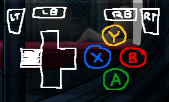

An overlay and helper python script that shows gamepad button presses on OBS.  Works via websocket.

How to use:
1. bring "controller.htm" into OBS as a browser source.  Load as a local file.
2. open a console or powershell window and run the python script.  Setup instructions are in the script at the top.

I made this because:
1. I wanted an excuse to make something
2. I didn't want to load yet another website or download yet another plugin to do something that doesn't require internet travel or program installation.

If you have any ideas or suggestions feel free to share, but keep change requests to yourself because I made this for me and not for public consumption.  It's here on github so people can look at it if they feel inspired to build on it.
